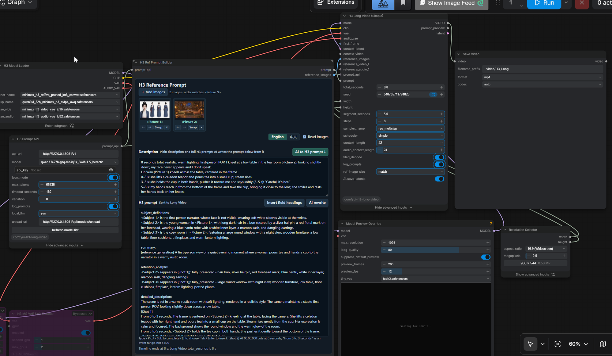
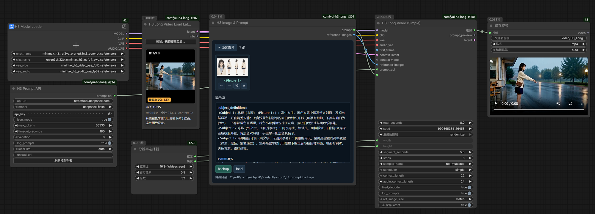
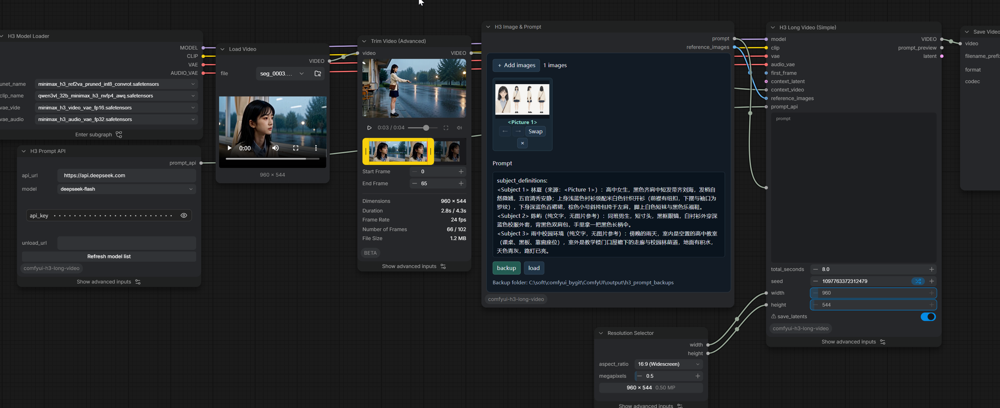
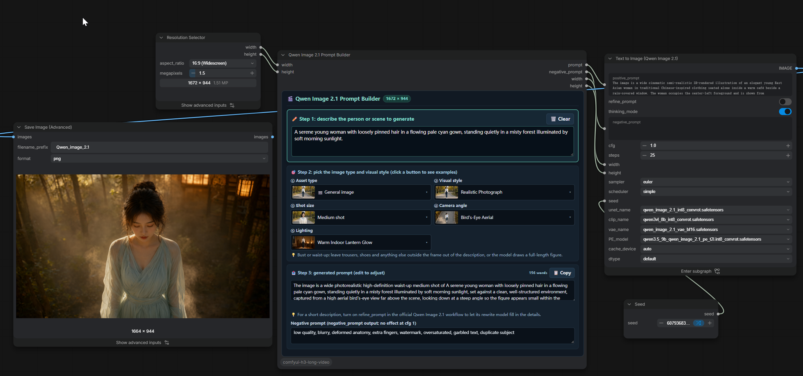

# H3 Long Video

[English](README.md)

一份提示词、一个总时长，生成任意长度的 MiniMax H3 视频。基于 [NikoDemon80/ComfyUI-H3-Motion-Context](https://github.com/NikoDemon80/ComfyUI-H3-Motion-Context)。

- **一份提示词，任意时长**：分段采样，每段接续上一段的画面和声音，最后以 24 fps 拼接。
- **接续任意视频**：从保存的 latent 的任意位置精确接续（不重新编码），或从视频文件接续。
- **提示词编辑器**：带备份的 H3 Image & Prompt，把描述写成 Ref2VA 六段提示词的 H3 Ref Prompt Builder，用中文或英文从图片反推提示词的 Image to Prompt，以及为视频前期生成角色设定卡、场景卡和首尾帧的 Qwen Image 2.1 Prompt Builder。
- **云端或本地大模型**把剧情拆成时间正确的各段提示词。

## 安装

在 ComfyUI Manager 中安装 **H3 Long Video**，或克隆到 `ComfyUI/custom_nodes`，然后重启 ComfyUI 并刷新浏览器。

```sh
git clone https://github.com/ooizj/ComfyUI-H3-Long-Video.git comfyui-h3-long-video
```

- 需要 **ComfyUI 0.36.0** 或更新版本（原生 H3 和 **Concatenate Video**）。
- **请先卸载原版 H3 Motion Context**，两者注册了相同的节点 ID。

## 快速开始

[](docs/images/ref-prompt-builder.png)

1. 打开示例工作流 [H3 Long Video - Ref Prompt Builder](example_workflows/H3%20Long%20Video%20-%20Ref%20Prompt%20Builder.json)，选择本机的模型和参考图。
2. 把 **H3 Prompt API** 接到 `prompt_api`，填写 API 密钥或本地服务地址。**视频需要多段时必须连接**，见[为什么要拆分提示词](#为什么要拆分提示词)。
3. 在 **H3 Ref Prompt Builder** 写好描述后点 **AI 生成 H3 提示词**，或自己写 H3 提示词。把 `total_seconds` 设为视频时长后运行，`VIDEO` 接 **Save Video**。

示例把 `segment_seconds` 设为 5 只是为了演示分段：8 秒视频分成两段采样，H3 Prompt API 负责把提示词拆到各段。实际使用建议保持默认的 15 秒，段数少，通常更快。较短的分段可降低单次采样显存，但会增加编码、解码和续接开销，显存不够时再调短。

<details>
<summary>示例工作流说明</summary>

示例在模型子图中保留了 LoRA / 注意力设置，请按本机安装调整。示例包含分辨率选择器，未安装时直接设置 Long Video 的 `width` 和 `height`。发布文件中的 API 密钥已清空。

</details>

## H3 Long Video (Simple)

| 输入 / 输出 | 用途 |
| --- | --- |
| `prompt`、`total_seconds` | 整片剧情和总时长。 |
| `prompt_api` | 把提示词拆成各段提示词。多段时必须连接。 |
| `reference_images` | 可选参考图，按 `<Picture N>` 顺序作用于所有段。有参考图时用 Ref2VA 模型，否则用兼容的 FL2VA/T2VA 模型。 |
| `reference_videos` / `reference_audios` | 可选 Ref2VA 参考，各最多 3 个，作用于所有段：`<Video N>` 和 `<Audio N>`（如音色）。参考视频自带的声音先占用下一个 `<Audio N>`，再轮到 `reference_audios`。其他帧率会重采样为 24 fps。 |
| `first_frame` | 可选首帧，只用于第一段开场。 |
| `last_frame` | 实验性功能。可选尾帧，钉在整条视频的最后一帧。前面各段也能看到它是整条视频的结尾，长镜头会沿用它的场景和机位，不会到最后一段才硬切过去。带不带参考都能用，可与 `first_frame` 一起用，接续视频时也能用。最后一段至少保留 4 秒新帧，不够时从前一段借帧。尾帧里的人和物要在提示词里写上，否则可能在结尾突然出现。 |
| `context_latent` / `context_video` | 可选，接续之前的视频，见[接续视频](#接续视频)。 |
| `VIDEO` | 生成的视频。 |
| `prompt_preview` | 实际的各段提示词和时间窗口，可接文本显示节点检查。 |
| `latent` | 最后一段的 latent，可接到另一个 Long Video 的 `context_latent`。 |

> **⚠ `save_latents` 默认开启。** 每段的 latent、MP4 和 `manifest.json` 都保存到 `output/h3_long_video/<运行>`，以便之后接续。**这些文件不会自动删除，请自行清理旧的运行。**

<details>
<summary>全部参数</summary>

| 参数 | 默认值 | 用途 |
| --- | --- | --- |
| `total_seconds` | `30` | 最终视频总时长。视频可能最多长 16 帧（0.67 秒），按 H3 帧网格向上取整，以便从结尾精确接续。 |
| `segment_seconds` | `15` | 每段采样目标时长，包含重叠；实际段长会受帧对齐及对白保护影响。 |
| `width` / `height` | `960` / `544` | 输出尺寸，向上对齐到 32 的倍数。 |
| `seed` | `0` | 各段使用 `seed + 段索引`，索引从 0 开始。 |
| `steps` | `20` | 每段采样步数。 |
| `sampler_name` / `scheduler` | `res_multistep` / `simple` | 采样器与调度器。 |
| `context_length` | `22` | 视频续接的重叠帧数，可选 `5`、`22`、`39`、`56`。 |
| `audio_context_length` | `24` | 音频续接窗口，以视频帧为单位；`0` 跟随视频重叠。 |
| `tiled_decode` | `true` | 分块解码，降低解码显存。 |
| `ref_image_size` | `match` | Ref2VA 参考图尺寸：`match` 缩放到视频的像素面积；`max` 保留最高 2048 像素短边，身份还原最好，但采样可能慢好几倍。需要 H3 参考节点带此选项的 ComfyUI。 |
| `⚠ save_latents` | `true` | 保存每段的 latent、MP4 和 `manifest.json`，见上方说明。 |

</details>

## 接续视频

`context_latent` 和 `context_video` **只接一个**。新视频从源视频的结尾开始，`VIDEO` 只包含新内容，用 **Concatenate Video** 把两段拼起来。提示词只写新内容，时间从 0 秒开始。

| | 从保存的 latent（`context_latent`） | 从视频（`context_video`） |
| --- | --- | --- |
| 来源 | 开启 `save_latents` 的 Long Video 运行 | 任意视频，必须正好是 `width` x `height`、24 fps |
| 接续位置 | 任意位置，约每 0.71 秒一个 | 任意一帧 |
| 画质 | 精确，不解码也不重新编码 | 最后几帧会重新编码 |

### 从保存的 latent 接续

[](docs/images/long-video-continue.png)

1. 添加 **H3 Long Video Load Latent**，`latent` 接到 Long Video 的 `context_latent`。
2. 点 **预览并选择接续位置…**：选择保存的视频，播放或拖动时间轴，点 **从 … 接续**。节点上会显示接续点那一帧。
3. `width`/`height` 设为保存视频的尺寸。
4. 用 **Concatenate Video** 把 Load Latent 的 `video`（保存的视频截到接续点）和 Long Video 的 `VIDEO` 拼起来。

默认接续最新保存视频的结尾。接续点位于 H3 的 17 帧 latent 网格上，约每 0.71 秒一个；选择时自动吸附到最近的一个，也可用 **上一个 / 下一个续接点** 逐个切换。另一个 Long Video 的 `latent` 输出也可以接到 `context_latent`。

### 从视频接续

[](docs/images/long-video-continue-video.png)

1. **Load Video（加载视频）** → **Trim Video (Advanced)（修剪视频（高级））** → Long Video 的 `context_video`。修剪是可选的：设置结束帧即可从结尾之前接续。
2. `width`/`height` 设为视频的尺寸。
3. 视频最后 `context_length` 帧画面和 `audio_context_length` 的声音会被固定为续接条件。

<details>
<summary>规则与报错</summary>

- 不做任何缩放或转换：尺寸或帧率不一致时节点停止并说明原因。其他视频请先转换，例如 `ffmpeg -i in.mp4 -vf "fps=24,scale=960:544:force_original_aspect_ratio=increase,crop=960:544" out.mp4`。
- 两个输入同时接入，或与 `first_frame` 一起接入，都会被拒绝。
- `context_latent` 必须是完整的 H3 音视频 latent，或由 Load Latent 截取的 latent；latent 不能缩放，尺寸不一致会被拒绝。

</details>

## 为什么要拆分提示词

长视频按段分别采样，每段都有从零开始的段内时间。若每段都收到整片剧情，后续段会重复开场动作或对白，或把整片时间误当成段内时间。**因此视频需要多段时必须连接 `prompt_api`，未连接时节点会报错停止。** 只生成一段时，把 `total_seconds` 设为不超过 `segment_seconds`。

建议在提示词里写清整片时间段和对白；没写时间时，按剧情顺序把内容分配到各段。

<details>
<summary>拆分过程</summary>

1. LLM 列出提示词中带时间的对白、切镜、动作、音效和音乐。
2. 节点在不切断对白的位置分段，再把整片时间换算为各段的段内时间（计入重叠窗口）。
3. LLM 按这些时间把整片提示词改写成各段需要的内容，沿用原文的描述语言。

分段规则：

- 两句对白紧挨着时，可以在前一句标注的结束时间之前最多 0.67 秒处分段。
- 只有所在镜头时间、没写自己时间的台词，按说完所需时间结束（约每秒 4 个汉字或 2.5 个英文词），不再占满整个镜头，否则 H3 会重复这句台词来填满。写了自己时间的台词（如 `旁白（6–15 秒）：`）和歌词保持原时间。
- 比一段还长的对白按标点拆开，时间按字数分配。
- 附近找不到切点时，该段会长于 `segment_seconds`，控制台会提醒这一段需要更多显存。

| 情况 | Long Video 是否调用 API |
| --- | --- |
| 未连接 `prompt_api`，且需要多段 | 不运行，请连接 `prompt_api`。 |
| 实际只需一段，即使已连接 `prompt_api` | 不调用，直接使用原提示词。 |
| 已连接 `prompt_api`，且需要多段 | 调用 API 分析时间线，再改写各段提示词。 |
| 提示词、时长和 API 设置与最近一次相同，例如只改了 seed | 不调用，复用当时规划的各段提示词。需要新的提示词时修改 Prompt API 的 `variation`。 |

Builder 的 AI 按钮是独立操作，点击时会调用它所连接的 API。仅仅不写时间戳不等于关闭 API。

</details>

### H3 Prompt API：云端或本地模型

`model` 下拉框列出 API 在 `/models` 接口报告的模型（修改 `api_url`、`api_key` 或点击 **刷新模型列表** 时更新；没有列出模型时显示 `default`）。云端 API 和本地服务（llama.cpp / llama-swap、Ollama、LM Studio）用法相同。

拆分提示词需要能力足够的模型。我们的测试中，本地 27B 稠密模型在定时对白、切镜和音乐上写出的段内时间都正确，DeepSeek 在定时对白上也正确；35B-A3B MoE 模型有时漏掉切镜；9B 模型经常违反对白规则。

<details>
<summary>本地大模型与显存</summary>

本地大模型与 H3 共用显卡。`local_llm`（高级选项，默认 `auto`）把指向本机（`localhost`、`127.0.0.1`）的 `api_url` 视为本地模型。`free_vram` 开启时（默认），每次请求 LLM 前先卸载 ComfyUI 模型；规划或 AI 改写结束后向 `unload_url` 发送 POST，让服务在采样前释放显存。LLM 跑在另一块显卡等情况下可关闭 `free_vram`，两边模型都保留在显存中。llama-swap 填 `http://127.0.0.1:8081/api/models/unload`；服务会自动卸载空闲模型时留空即可。

本地大模型且开启 `json_mode` 时，请求会附带 JSON Schema，llama.cpp、Ollama、LM Studio 只能按规定结构输出：每段一个对象、每个提示词段落一个字段，Builder 则是六个字段；段落标题由节点自己写入。

</details>

<details>
<summary>提示词日志</summary>

启用 `log_prompts` 后，日志保存在 `output/h3_prompt_logs/`（TXT + JSON）：`*_builder` 是 Ref Prompt Builder 的 AI 请求记录，`*_image_prompt` 是 Image to Prompt 的请求记录，`*_planner` 是 API 规划记录，`*_video` 是采样前确定的各段提示词与设置。`prepared` 仅表示准备采样。密钥遮罩只隐藏显示，不影响工作流中保存的值，分享工作流前请清空密钥字段。

</details>

## H3 Image & Prompt

[](docs/images/image-and-prompt.png)

在一个节点里管理图片和提示词（`video/minimax` 分类）。添加、拖入或粘贴图片，用箭头排序（提示词中的 `<Picture N>` 同步更新），点击缩略图插入引用。`prompt` 和 `reference_images` 接到 Long Video。

<details>
<summary>备份与载入</summary>

- **backup** 把原图、`prompt.txt` 和记录图片顺序、来源及哈希的 manifest 保存到 `output/h3_prompt_backups` 下新的时间戳目录。备份不会互相覆盖，普通运行也不会自动备份。
- **load** 按时间倒序列出备份，显示缩略图和提示词的 summary。选中后可查看图片（点击放大）和排版后的提示词，再点 **载入所选备份**。载入使用备份中的图片副本，不依赖原来的上传图片。
- 图片尺寸不同时补边组批，不裁切；没有图片时也可以只输出提示词。

</details>

## H3 Ref Prompt Builder

[](docs/images/ref-prompt-builder.png)

编辑参考图、描述和 Ref2VA 提示词（`video/minimax` 分类），手动填写无需 API。

1. 添加、拖入或粘贴参考图，顺序对应 `<Picture 1>`、`<Picture 2>` 等。拖动卡片或点击箭头排序时，正文中的编号同步更新；**换**用于替换图片并保留编号。
2. 在 **描述** 框写普通描述后点 **AI 生成 H3 提示词**，或直接在 **H3 提示词** 框按六段字段标题书写（**插入六段标题** 可补上标题）。描述会保留，方便修改后重新生成。点击缩略图插入引用，或输入 `<Pic` / `<Sub` 后用方向键、Tab / Enter 补全。`<Subject N>` 需明确绑定来源图片，不要求与图片编号相同。
3. 把 `prompt` 和 `reference_images` 接到 Long Video 后运行。编辑器显示时间线写到第几秒，与所连 Long Video 的 `total_seconds` 不一致时给出提示。

<details>
<summary>六个字段</summary>

| 字段 | 内容 |
| --- | --- |
| `subject_definitions` 主体定义 | 人物、场景等主体的特征及来源，例如 `<Subject 1> 是 <Picture 1> 中穿深色衬衫的男子。` |
| `summary` 内容概述 | 视频的主要事件；使用 `[reference generation]`，有首帧或关键帧时使用 `[keyframe completion + reference generation]`。 |
| `retention_analysis` 参考保留规则 | 参考图中需要保留的身份、服装、环境等特征。 |
| `detailed_description` 画面与动作时间线 | 构图、动作、运镜、对白和局部音效，时间按最终整片视频填写。 |
| `overall_soundscape` 整体环境声 | 贯穿视频的环境底声与总体听感。 |
| `non_diegetic_music` 背景音乐 | 音乐要求；不要音乐时填写 `N/A`。 |

开场写 `[Shot 1]`，六秒切镜写 `[Shot 2] At 00:06.000, ...`；`0–3 秒：……` 是事件时间段，不等于切镜。提示词总时长与 Long Video 的 `total_seconds` 保持一致。

</details>

<details>
<summary>AI 整理与语言</summary>

- **AI 整理：** 把 H3 Prompt API 接到 Builder 的 `prompt_api`。只有 **AI 生成 H3 提示词** 和 **AI 整理** 会请求 API，只排队处理提示词，不启动视频生成。前者把描述写成六段，后者按段整理现有的 H3 提示词。结果替换 H3 提示词框的内容；用 ComfyUI 的撤销/重做（光标不在输入框时按 Ctrl+Z / Ctrl+Y）可逐步退回或恢复 AI 结果、插入的标题和图片操作。等待期间编辑过原文时，点 **应用 AI 结果** 才替换。
- **AI 输出语言：** 用 English / 中文 按钮切换，默认 English（H3 官方 Ref2VA 格式）。台词、歌词和画面文字保留原语言。选择随节点保存，并作为新建节点的默认值。
- **识图：** 默认开启，把图片压缩为最长边 1024px 的 JPEG 副本发送给视觉模型。纯文字模型请关闭。视频生成仍使用源图片。
- **界面语言：** 编辑器、节点说明和 tooltip 跟随 ComfyUI 的语言设置：中文环境显示中文，其他语言显示英文。

</details>

## Image to Prompt

用所连 H3 Prompt API 的视觉模型从图片反推生图提示词（`video/minimax` 分类）。接上 `image` 和 `prompt_api`，再选择 `mode` 和 `language`（English 或 中文）。

- `full_prompt` 写出主体、场景、构图、机位、光线和风格。把 `prompt` 接到任意生图模型的文本输入，例如 CLIP Text Encode。
- `subject_only` 不写风格、景别、机位和光线。把 `prompt` 接到 Qwen Image 2.1 Prompt Builder 的 `prompt` 输入，由它的预设补齐；连接后第一步的描述框置灰，运行时使用连接的文本。
- 批量图片逐张单独请求，各段提示词之间空一行。
- Prompt API 的 `model` 需要支持图片输入。图中可见的文字保留原语言。

## Qwen Image 2.1 Prompt Builder

[](docs/images/qwen-image-prompt-builder.png)

为视频前期要用的图片生成 Qwen Image 2.1 提示词：角色设定卡、无人物场景卡、产品锚点图、游戏菜单图、RGBA 抠图和关键帧（`video/minimax` 分类），无需大模型。

1. 把「分辨率选择器」的 `width` 和 `height` 接到节点。提示词按宽高写横图、竖图或方图，两个值原样从输出传出。
2. 填写人物或场景描述，再选择资产类型、风格、景别、机位和光影。点选项按钮可查看示例图。
3. 把 `prompt`、`negative_prompt`、`width`、`height` 接到官方 Qwen Image 2.1 流程。可直接修改预览框里的提示词，修改会一直保留，直到点 **恢复自动生成**。

- 胸像或半身时，描述里不要写裤子和鞋子，否则会画成全身。
- 描述较短时，在 Qwen Image 2.1 流程中开启 `refine_prompt`。cfg 为 1 时 `negative_prompt` 不生效。

[GPL-3.0 许可证](LICENSE)
